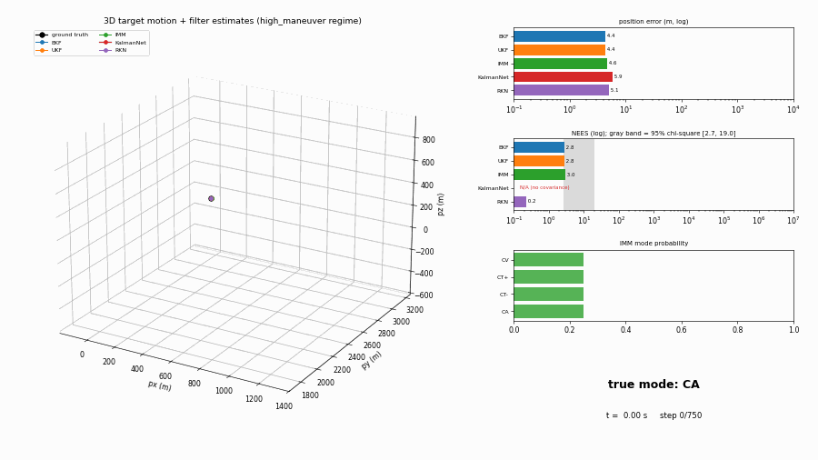

# KalmanNet vs. IMM

Does a learned Kalman filter beat a well-tuned classical IMM for maneuvering-target tracking
with azimuth/elevation/range measurements, on an edge tracker where the GPU is reserved for the
vision pipeline?

Short answer: not yet. A tuned IMM still wins on nominal accuracy, on calibration and on cost, but
Recursive KalmanNet now comes within 1.3x of it and beats it under hard maneuvers.

| | IMM | KalmanNet (vanilla) | RKN |
|---|---|---|---|
| Diverged runs (> 200 m), nominal | 0% | 86.3% | 0% |
| Position RMSE, nominal (m) | **1.17** | 74.57 (before divergence) | 1.49 |
| Position RMSE, high_maneuver (m) | 2.53 | 79.41 (before divergence) | **1.89** |
| High-MC ANEES (bounds 8.19-9.85) | **9.53** | N/A (no covariance) | 15.02 |
| Coverage @68/95 | 0.702 / 0.862 | N/A | 0.553 / 0.732 |
| Median CPU latency (ms) | 0.239 | 0.333 | 0.559 |
| Params | 0 | 526,116 | 301,266 |

What keeps RKN out: its covariance is learned from nominal-noise data and does not follow a
noisier sensor (ANEES 86 at 4x measurement noise, where IMM, which is given the new `R`, stays
at 8.8). Vanilla KalmanNet
produces no covariance at all (state dim 9 > measurement dim 3) and diverges in most runs.

Full write-up, methodology, deployment analysis and the conditions that would flip the verdict:
[the write-up](https://pavelguzenfeld.github.io/kalmannet-vs-imm/docs/view.html?doc=write-up.md). Literature extraction the implementations are grounded in:
[the source notes](https://pavelguzenfeld.github.io/kalmannet-vs-imm/docs/view.html?doc=source-notes.md).



## Running it

Everything runs in a CPU-only Docker image; `docker_run.sh` builds it and mounts this repo at
`/work`.

```
./docker_run.sh pytest -q                        # 340 tests
./docker_run.sh python scripts/make_dataset.py   # -> datasets/
./docker_run.sh python scripts/tune_imm.py
./docker_run.sh python scripts/eval.py           # classical filters -> results/
./docker_run.sh python scripts/train_knet.py && ./docker_run.sh python scripts/eval_knet.py
./docker_run.sh python scripts/train_rkn.py  && ./docker_run.sh python scripts/eval_rkn.py
./docker_run.sh python scripts/bench_latency.py --knet-checkpoint results/knet_vanilla/best.pt \
    --rkn-checkpoint results/rkn/best.pt --bench-rkn-reference-default
./docker_run.sh python scripts/make_plots.py
./docker_run.sh python scripts/make_animation.py
```

Run them in that order. Each step reads the previous step's output from its default path.
Generated datasets, checkpoints and results are gitignored; regenerate them with the commands
above. Every results artifact records the host `GIT_COMMIT` it was produced at.

## Layout

```
scripts/              entrypoints, one per pipeline stage; run from the repo root
filters/              the library: EKF, UKF, IMM, motion/measurement models, metrics
filters/knet/         KalmanNet and Recursive KalmanNet (torch)
data/                 the trajectory generator and regime definitions
tests/                unit tests -- `./docker_run.sh pytest -q`
docs/assets/          the README animation
docker/               the CPU-only image both CI and docker_run.sh use

datasets/             generated trajectories (gitignored)
results/              every artifact the pipeline writes, plots included (gitignored)
```

## Checks

CI (`.github/workflows/ci.yml`) lints with ruff, runs the unit tests in the bench image, and
smokes the pipeline above at toy sizes on its default paths. The unit tests import the packages
directly and so never execute an entrypoint.

Pre-commit adds the diff-scoped mutation gate over `filters/` and `data/`:

```
pip install pre-commit && pre-commit install
```

## References

What the filters and the comparison are built on (extracted in [the source notes](https://pavelguzenfeld.github.io/kalmannet-vs-imm/docs/view.html?doc=source-notes.md)):

1. H. A. P. Blom, Y. Bar-Shalom, "The interacting multiple model algorithm for systems with Markovian switching coefficients," *IEEE Trans. Automatic Control* 33(8), 780–783, 1988. [doi:10.1109/9.1299](https://doi.org/10.1109/9.1299)
2. Y. Bar-Shalom, X.-R. Li, T. Kirubarajan, *Estimation with Applications to Tracking and Navigation*, Wiley, 2001. [doi:10.1002/0471221279](https://doi.org/10.1002/0471221279)
3. G. Revach, N. Shlezinger, X. Ni, A. L. Escoriza, R. J. G. van Sloun, Y. C. Eldar, "KalmanNet: Neural network aided Kalman filtering for partially known dynamics," *IEEE Trans. Signal Processing* 70, 1532–1547, 2022. [doi:10.1109/TSP.2022.3158588](https://doi.org/10.1109/TSP.2022.3158588), [arXiv:2107.10043](https://arxiv.org/abs/2107.10043)
4. H. Mortada, C. Falcon, Y. Kahil, M. Clavaud, J.-P. Michel, "Recursive KalmanNet: Deep learning-augmented Kalman filtering for state estimation with consistent uncertainty quantification," *EUSIPCO*, 885–889, 2025. [doi:10.23919/EUSIPCO63237.2025.11226444](https://doi.org/10.23919/EUSIPCO63237.2025.11226444), [arXiv:2506.11639](https://arxiv.org/abs/2506.11639)
5. M. Ko, A. Shafieezadeh, "Cholesky-KalmanNet: Model-based deep learning with positive definite error covariance structure," *IEEE Signal Processing Letters* 32, 326–330, 2025. [doi:10.1109/LSP.2024.3519265](https://doi.org/10.1109/LSP.2024.3519265)
6. Y. Dahan, G. Revach, J. Duník, N. Shlezinger, "Bayesian KalmanNet: Quantifying uncertainty in deep learning augmented Kalman filter," *IEEE Trans. Signal Processing* 73, 2558–2573, 2025. [doi:10.1109/TSP.2025.3581703](https://doi.org/10.1109/TSP.2025.3581703), [arXiv:2309.03058](https://arxiv.org/abs/2309.03058)
7. M. Mari, L. Snidaro, "Ensemble of KalmanNets for maneuvering target tracking," *FUSION*, 2024. [doi:10.23919/FUSION59988.2024.10706253](https://doi.org/10.23919/FUSION59988.2024.10706253); and "Ensemble of KalmanNets with innovation-based attention for robust target tracking," *Information Fusion* 127, 103777, 2026. [doi:10.1016/j.inffus.2025.103777](https://doi.org/10.1016/j.inffus.2025.103777)
8. N. Shlezinger, G. Revach, A. Ghosh, S. Chatterjee, S. Tang, T. Imbiriba, J. Duník, O. Straka, P. Closas, Y. C. Eldar, "Artificial intelligence-aided Kalman filters: AI-augmented designs for Kalman-type algorithms," *IEEE Signal Processing Magazine* 42(3), 52–76, 2025. [doi:10.1109/MSP.2025.3569395](https://doi.org/10.1109/MSP.2025.3569395), [arXiv:2410.12289](https://arxiv.org/abs/2410.12289)

2026 work on the same question, not yet folded into the benchmark:

- Y. Zhao, C. Yang, L. Gao, Y. Tian, T. Yuan, "IMMNet: Hybrid fusion of model-based and data-driven approaches for maneuvering target tracking," 2026. [arXiv:2607.13573](https://arxiv.org/abs/2607.13573) — IMM structure with learned components; the closest direct competitor.
- Z. Li, Y. Guo, J. Wang, "IMMnet: Learned multiple model fusion filter for intelligent vehicle pose estimation," *IEEE Sensors J.* 26(4), 5769–5776, 2026. [doi:10.1109/JSEN.2025.3646621](https://doi.org/10.1109/JSEN.2025.3646621) — learns the IMM fusion step.
- C.-B. Lim, D.-H. Paek, S.-H. Kong, "IMM-based multiple object tracking using a state prediction neural network," 2026. [arXiv:2609.13307](https://arxiv.org/abs/2609.13307) — adds a learned predictor as an extra IMM mode.
- W. Zhang, X. Ni, N. Shlezinger, Z. Wang, "Change-aware self-adaptive AI-aided Kalman filters with neural change point detection," 2026. [arXiv:2607.13387](https://arxiv.org/abs/2607.13387) — online change detection, the role IMM mode probabilities play.
- O. Cohen, N. Shlezinger, T. Routtenberg, "EM-KalmanNet: Learned expectation-maximization for adaptive tracking in partially known, block-wise time-varying state-space models," 2026. [arXiv:2608.24404](https://arxiv.org/abs/2608.24404) — regime switching, close to IMM's assumption.
- M. Ko, A. Shafieezadeh, "Unscented KalmanNet: Structure-preserving deep learning with calibrated posterior uncertainty under incomplete physics and unknown noise," 2026. [arXiv:2608.04201](https://arxiv.org/abs/2608.04201) — calibrated covariance, the axis vanilla KalmanNet fails on here.
- A. Mehrfard, B. Duraisamy, S. Haag, F. Geiss, M. Mählisch, "Adaptive learned state estimation based on KalmanNet," 2026. [arXiv:2604.02441](https://arxiv.org/abs/2604.02441) — scenario-adaptive KalmanNet with covariance estimation.
- J. Song, W. Mei, Y. Xu, Q. Fu, R. Kou, L. Bu, Y. Long, "Motion estimation for multi-object tracking using KalmanNet with semantic-independent encoding," *Information Fusion* 136, 104513, 2026. [doi:10.1016/j.inffus.2026.104513](https://doi.org/10.1016/j.inffus.2026.104513) — KalmanNet under mismatched KF parameters in MOT.
